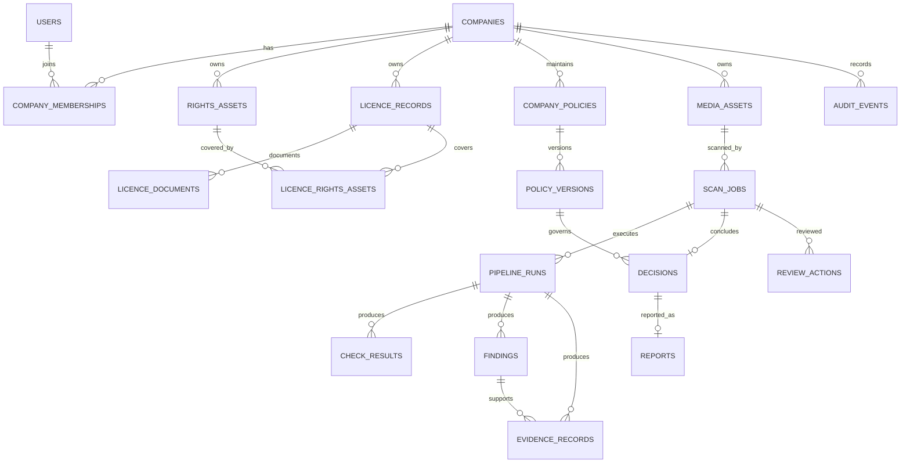

# Phase 2.1 database design

## Status and scope

This phase adds the initial versioned relational schema, JPA mappings, tenant-filtered repository methods, and schema/persistence test scaffolding. It does not add authentication, business APIs, upload handling, queue processing, analysis, or policy evaluation. Database columns and constraints are implemented in Flyway migration `V1__create_core_domain_schema.sql`; Hibernate is configured to validate mappings and never create or update the production schema.

The migration must be run against PostgreSQL 17 before this phase can be considered verified. The local H2 test profile is for mapping-level feedback only and is not a substitute for PostgreSQL integration verification.

## Relationship overview

All primary records use UUIDs. `created_at`, `updated_at`, `uploaded_at`, `decided_at`, and audit timestamps use timezone-aware PostgreSQL timestamps. Media and licence document binaries stay in private object/filesystem storage; the database stores metadata, checksums, and opaque storage keys.

## Tables and relationships

| Tables | Purpose and notable constraints |
| --- | --- |
| `companies`, `users`, `company_memberships` | Global identities and company membership. Membership is unique per company/user and records role/status. Users are not tenant-owned. |
| `rights_assets`, `licence_records`, `licence_rights_assets`, `licence_documents` | Tenant-owned registered works, permission records, explicit licence-to-work association, and private document metadata. Composite company foreign keys prevent linking a licence to another company's rights asset. |
| `company_policies`, `policy_versions` | Tenant-owned named policies and immutable-intent version records with JSONB rule configuration. Version numbers are unique per policy. |
| `media_assets` | Tenant-owned image metadata only. MIME type is constrained to JPEG, PNG, WebP; size and dimensions are checked; checksum and storage key uniqueness are company-scoped. Uploading user and matching company membership are retained. |
| `scan_jobs` | Tenant-owned jobs tied to a media asset, with queued/processing/completed/failed/cancelled lifecycle and retry/timing/error fields. |
| `pipeline_runs`, `check_results`, `findings`, `evidence_records` | Pipeline status follows the shared evidence contract; finding/check statuses retain PASS, FAIL, ADVISORY_FLAG, NOT_APPLICABLE, UNAVAILABLE, UNKNOWN. JSONB holds structured details. |
| `decisions`, `reports` | At most one decision per scan job and at most one report per decision. Decision values are APPROVE, REVIEW, BLOCK; reasons/rule/finding references are stored as JSONB. No score aggregation is modeled. |
| `review_actions`, `audit_events` | Tenant-owned actor and event history. Records are retained with restrictive deletion behavior; events may be system-authored with a null actor. |

## Tenant ownership and enforcement

Every business table contains `company_id` with a foreign key to `companies`. Cross-company relationships between tenant-owned records use composite foreign keys `(company_id, referenced_id)`. Actor references in media, review, and audit rows point to a membership in the same company, including the membership ID for a composite tenant key. A licence may cover multiple rights assets through the explicit join table; each edge has same-company composite foreign keys.

Repositories for core tenant queries expose methods that require `companyId` alongside the record ID or status. This is a safe access seam, not complete tenant isolation: no authentication exists yet, no server-derived active-company context is available, and generic `JpaRepository` methods still exist. Future API services must obtain company context from authenticated membership, pass it to every query, and never accept frontend company IDs as authority. Add cross-tenant authorization tests when authentication and business APIs arrive. Database row-level security and storage namespace checks are future defense-in-depth work.

## Indexing and deletion

Indexes cover membership lookups, company/status lists, recent media, queued jobs, pipeline children, decisions, review history, and audit chronology. Unique constraints enforce slugs, email, memberships, per-company external references/storage keys, policy versions, and one decision/report per workflow parent. Company, user, rights, media, decisions, and audit references use restrictive deletion to preserve provenance. Pipeline children may cascade with their run; licence documents cascade with their licence. Audit events are append-oriented and should be retained by operational policy; no purge API is provided.

## Storage and privacy assumptions

Only metadata and opaque logical keys are stored in PostgreSQL. Local filesystem remains the default storage provider seam; Backblaze B2 remains optional and has no client or credential requirement in this phase. Storage keys must not be returned as public URLs. No uploaded media is placed in frontend static assets. Sensitive licence terms and content must not be logged.

## Migration history

| Version | Migration | Status |
| --- | --- | --- |
| 1 | `V1__create_core_domain_schema.sql` | Added in Phase 2.1; PostgreSQL 17 execution remains to be verified. |

Flyway is enabled at `classpath:db/migration`. Hibernate `ddl-auto` is `validate`. Never edit a migration after it has been applied to a shared database; add a forward migration instead. No volume reset or data deletion is part of this phase.

See [Phase 2.1 verification](phase-2.1-verification.md) for executed checks and blocked gates.

## Known limitations and future dependencies

- Authentication, membership authorization, service-layer tenant context, and full tenant-isolation tests are not implemented.
- JPA mappings cover core aggregates and use unidirectional lazy references. Composite database ownership constraints exceed some navigable JPA association mappings; Hibernate validation against PostgreSQL remains an unverified gate.
- PostgreSQL 17 migration and repository integration testing is required. H2 compatibility does not establish PostgreSQL behavior.
- Scan production, queue publishing/consumption, retries, analysis, deterministic policy evaluation, human review endpoints, report creation, object storage, retention jobs, and audit append service are future phases.
- Application-level validation must enforce consistent company ownership when constructing associations in addition to composite database constraints.
